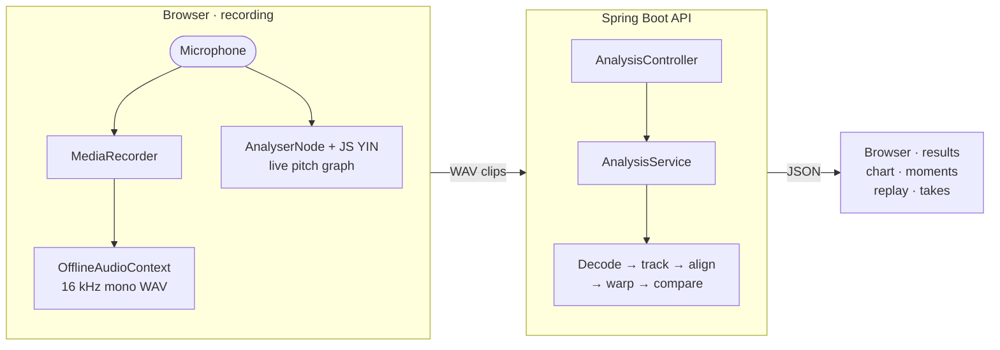
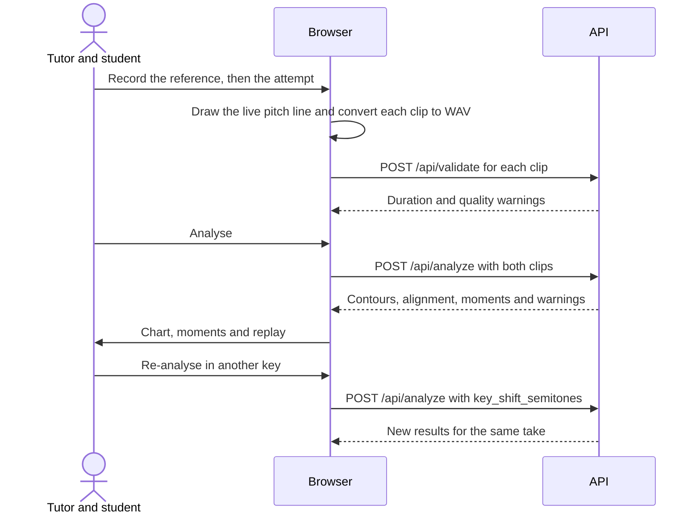

# Paaduta Teeyaga

**Live:** [srujanakalluru.github.io/paaduta-teeyaga](https://srujanakalluru.github.io/paaduta-teeyaga/) · **API:** [paaduta-teeyaga.onrender.com](https://paaduta-teeyaga.onrender.com/api/health)

A singing practice coach that compares a live reference phrase with an attempt and reports the below moments to practise
- flat or sharp notes
- late or early entries
- wavering pitch
- missed or extra singing.

Every moment has a confidence score from the signal analysis.

## 1. Features

- Records two live clips of up to 3 minutes each and returns contours, alignment, warnings and a moment per 10 seconds of singing, between 5 and 20.
- Aligns clips automatically. Asks for a new recording when alignment is weak.
- Processes requests in memory. Keeps session state in the browser.

## 2. Architecture





## 3. Analysis pipeline

All stages work in 20 ms frames.

**Decode (`AudioDecoder`)**
- Converts any PCM WAV to 16 kHz mono with `javax.sound`.
- Rejects input with `unsupported_format`, `corrupt_audio`, `empty_audio` or `too_long` (over 180 s).

**Pitch (`PitchTracker`)**
- Runs YIN over 65–1100 Hz with a 32 ms window.
- Treats frames below −50 dBFS as silence. Frames without a clear pitch get a null `f0`.
- Drops voiced runs shorter than 60 ms.
- Moves a frame back when it sits an octave away from the median of the surrounding 0.2 s. Sustained octave leaps are kept.

**Coarse alignment (`Aligner`)**
- Picks the lag with the most overlapping voiced frames.
- Reports confidence as the fuzzy intersection-over-union of the two voicing curves.
- Breaks near-ties by lining up the first sung notes.
- Flags nothing below 0.5 confidence and returns `weak_alignment`.

**Fine alignment (`Warp`)**
- Applies dynamic time warping within 0.74 s of the coarse lag.
- Costs pitched frames by their semitone difference and other frames by their voicing difference.
- `STEP_PENALTY` (0.15) is the most sensitive constant. A lower value aligns wrong notes with nearby correct ones. A higher value stops the warp following tempo changes.
- Marks reference frames as not sung when the warp holds one attempt frame for more than 0.2 s.

**Comparison (`Comparison`)**
- Keeps one moment per 10 seconds of reference singing, between 5 and 20, choosing the most confident and sorting them by time.
- **Key:** a median difference of 150 cents or more counts as a key shift. Pitch moments are withheld with `possible_key_mismatch` until the user picks a key.
- **Timing:** runs first, and other detectors skip its frames. Each entry is compared with the nearest of the overall lag and its neighbours' lags, so gradual drift is ignored. The first entry is never reported.
- **Missed and extra:** 0.2 s or more where one recording has singing and the other has none.
- **Pitch:** a 180 ms running median smooths vibrato. A difference beyond ±50 cents for 0.2 s or more is flat or sharp.
- **Unsteady:** half-second stretches centred on the reference pitch with a spread of 70 cents or more.

| Property | Default | Effect |
|---|---|---|
| `analysis.pitch-cents` | 50 | Flat and sharp threshold |
| `analysis.min-issue-seconds` | 0.2 | Minimum moment length |
| `analysis.min-issue-confidence` | 0.6 | Minimum confidence |
| `analysis.timing-seconds` | 0.2 | Minimum reported entry offset |
| `analysis.min-alignment-confidence` | 0.5 | Below this, nothing is flagged |
| `analysis.seconds-per-issue` | 10 | Seconds of singing per moment |
| `analysis.min-issues` | 5 | Fewest moments returned |
| `analysis.max-issues` | 20 | Most moments returned |
| `analysis.unsteady-cents` | 70 | Spread that counts as wavering |
| `app.cors.allowed-origins` | `https://*.github.io`, localhost | Origins allowed to call the API |

- Every property can be set as an environment variable, such as `ANALYSIS_PITCHCENTS`.
- All other numbers are configurable in `AnalysisConstants` and `AudioConstants`.

## 4. Code layout

```
com.paaduta
├── controller   AnalysisController        HTTP in, DTO out
├── service      AnalysisService           orchestration, warnings, logging
├── analysis     AudioDecoder, PitchTracker, Aligner, Warp, Comparison
├── model        Contour, Alignment, Issue, ComparisonResult
├── dto          AnalysisResponse, Contours, Summary, Notice, ValidationResponse
├── config       AnalysisProperties, WebConfig (CORS)
├── constants    AudioConstants, AnalysisConstants, ApiConstants, ErrorCode, Warning
├── exception    AnalysisException, ApiExceptionHandler (RFC 7807)
└── util         Stats
static/          index.html, app.js, audio.js, chart.js, staff.js, voice.js, lessons.js, listen.js, constants.js, app.css
                 lessons.json, lessons.schema.json   the curriculum
```

## 5. API

| Endpoint | Purpose |
|---|---|
| `GET /api/health` | Returns `{"status":"ok"}` |
| `POST /api/analyze` | Multipart `reference_audio` and `user_audio` (WAV), optional `key_shift_semitones` (`0` = same key) |
| `POST /api/validate` | Multipart `audio` and optional `track`. Returns duration and quality warnings |

- OpenAPI document: `/v3/api-docs`. Swagger UI: `/swagger-ui.html`.

```json
{
  "status": "ok",
  "alignment": { "offset_seconds": 0.5, "confidence": 0.9, "method": "voicing_overlap" },
  "summary": { "analysable_seconds": 8.1, "pitch_comparison_confidence": "high", "candidate_issues": 1 },
  "contours": { "time_seconds": [0.0, 0.02], "attempt_time_seconds": [0.5, 0.52], "deviation_cents": [null, -12.4] },
  "issues": [{ "id": "issue-1", "start_seconds": 4.3, "end_seconds": 5.0, "type": "pitch_deviation",
               "direction": "flat", "median_deviation_cents": -80.0, "confidence": 0.99 }],
  "warnings": [], "key_shift_semitones": 0, "detected_key_shift_semitones": 0
}
```

- Contours are timed on the reference. `attempt_time_seconds` gives the matching point in the attempt for replay.
- Issue types are `pitch_deviation`, `timing`, `unsteady`, `missed` and `extra`.
- The status is `insufficient` when either clip has less than 0.3 s of pitched audio.
- Invalid input returns `422` with `code` and `track`. Oversized uploads return `413`.

## 6. Frontend

- All session state is one in-memory object in `app.js`. **Reset** reloads the page to clear it.
- The `<meta name="api-base">` tag is empty when Spring serves the page. The Pages build sets it to `API_BASE_URL`.
- The chart shifts the attempt by the chosen key, so voices an octave apart overlap.
- The record buttons stay disabled while a recording starts or stops. This prevents a second recorder.
- Lessons run in one-tap flow: opening a lesson plays its reference, the record button pulses when it ends, the learner can re-record as often as they like before pressing Analyse, and the result offers Next lesson or Try again. The home page offers Continue once there is progress.

### Editing the lessons

The curriculum is in `src/main/resources/static/lessons.json`. No code changes are needed to add or reorder lessons. Editors that read `lessons.schema.json` check the structure as you type.

```json
{
  "title": "Small steps",
  "about": "Move between neighbouring notes.",
  "chapters": [
    {
      "title": "Two notes",
      "hint": "Step to the next note, then back.",
      "secondsPerBeat": 1,
      "lessons": [
        {"swaras": "S R"},
        {"title": "Sarali Varasa 1", "swaras": "S R G M P D N S' | S' N D P M G R S", "theory": "Purandara Dasa set these exercises some 500 years ago."}
      ]
    }
  ]
}
```

- **Stage**: a group of chapters that adds one new idea. Only the stage being worked on starts open.
- **Chapter**: `secondsPerBeat` sets the tempo (1 is 60 beats a minute). `beatsPerLine` sets the taalam cycle and defaults to 8. A stage or chapter can set `ragam` (`mayamalavagowla`, the default, or `sankarabharanam`); a lesson can set its own `beatsPerLine`.
- **Speed and akaram**: every lesson can be played in first, second or third speed and sung on swara names or on 'aa'; these are choices on the lesson page, not separate lessons.
- **Swaras**: `S R G M P D N`. Add `'` for the upper octave (`S'`) and `.` for the lower (`N.`). A comma holds the previous swaram one more beat and `|` separates lines.
- **Listening game**: instead of `swaras`, give a `title` and `"listen": {"intervals": [7, 4], "same": false, "rounds": 8}`. Two notes within one octave play and the learner answers up, down or same; only then are the notes shown on a ladder. `intervals` are jump sizes in semitones (7 Sa to Pa, 4 Sa to Ga, 2 Sa to Ri, 1 Ga to Ma). With `"demo": true` the notes are shown as they play and nothing is asked.
- **Theory**: optional. Three or four lines shown above the lesson to make it interesting.
- **Title**: optional. Without it the swaras are the name. Renaming a lesson resets its saved progress.
- A mistake, such as an unknown swara or two lessons with the same name, is shown on the page when it loads.

## 7. Build and test

```bash
./mvnw spring-boot:run      # http://localhost:8080
./mvnw verify
```